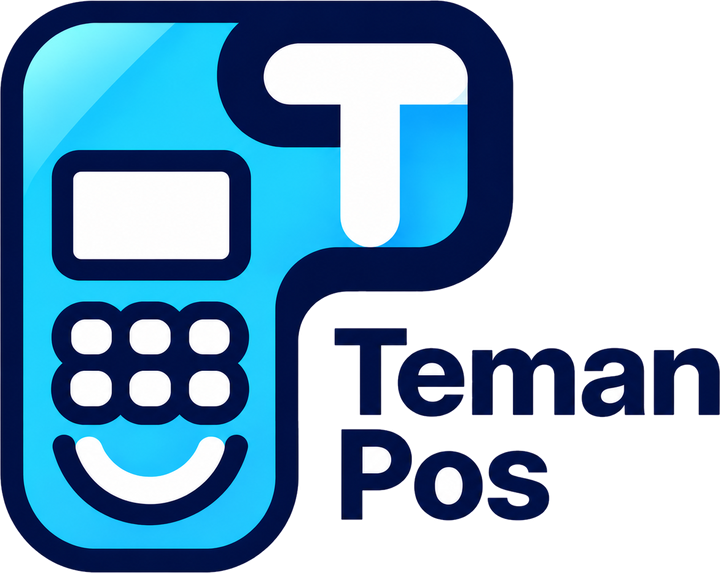

<p align="center">
  
</p>

# TemanPOS

Aplikasi POS (kasir) Android untuk UMKM F&B, dibuat sebagai **template**: satu APK untuk banyak toko,
setiap toko punya database Supabase sendiri.

**Stack:** React Native · Expo SDK 58 (Expo Router) · TypeScript · NativeWind · Zustand · TanStack Query · Supabase

Semua keputusan produk ada di folder [`docs/`](docs/00-README.md).

## Fitur

| Mode | Isi |
|------|-----|
| **Kasir** (tablet landscape, tanpa login) | Menu & keranjang (varian, topping, catatan), dine-in / takeaway / ojol, member, diskon, bayar → struk tercetak otomatis, riwayat order & batal, pengeluaran, stok, laporan, member, setting |
| **Owner** (HP portrait, masuk pakai PIN) | Dashboard hari ini + akses cepat, order masuk realtime + bunyi *cekring*, laporan (omzet, laba, jam ramai, menu terlaris), kelola produk, setting |

- Printer thermal **Bluetooth** 58 / 80 mm (cetak otomatis setelah Lunas & cetak ulang)
- **Realtime**: order, menu, dan pengeluaran langsung ter-update di semua device
- Satu akun toko untuk semua device, PIN owner 4 digit (awal `0000`)

## Setup pertama kali (laptop baru)

1. Install [Node.js](https://nodejs.org) (versi LTS) dan [Git](https://git-scm.com).
2. Clone repo lalu install library:
   ```bash
   git clone https://github.com/refiepratama-dev/FnB_PosApp.git
   cd FnB_PosApp
   npm install
   ```
3. Salin `.env.example` jadi `.env`, lalu isi URL & anon key Supabase development
   (minta ke Refie lewat chat pribadi). **File `.env` jangan pernah di-commit.**
4. Install **APK development TemanPOS** di HP/tablet Android (link minta ke Refie).
   > Expo Go **tidak dipakai lagi**: fitur printer Bluetooth hanya jalan di development build.

## Menjalankan app

```bash
npx expo start
```

1. Buka aplikasi **TemanPOS** (bukan Expo Go) di HP/tablet.
2. Pilih laptop di daftar *Development servers*, atau scan QR di terminal.
   Laptop dan HP harus di WiFi yang sama. Kalau tidak tersambung: `npx expo start --tunnel`.
3. Di layar **Hubungkan ke Toko**, pilih **Pakai toko development (.env)**.
4. Login akun toko, lalu pilih **Kasir** atau **Owner**.

Perubahan kode langsung muncul di HP setelah file disimpan (tekan `r` di terminal untuk reload manual).

## Perintah penting

| Perintah | Fungsi |
|----------|--------|
| `npx expo start` | Jalankan app (ke aplikasi TemanPOS dev build) |
| `npx expo start -c` | Jalankan app + hapus cache (kalau tampilan aneh) |
| `npm run typecheck` | Cek error TypeScript sebelum bikin PR |
| `npm test` | Jalankan unit test |
| `npx expo install <nama-library>` | Tambah library (jangan pakai `npm install` biasa) |
| `npm run qr-toko` | Buat QR & kode koneksi untuk toko baru |

## Build APK (EAS)

Butuh akun Expo yang terdaftar di project (`npx eas-cli@latest login`).

| Perintah | Hasil |
|----------|-------|
| `npx eas-cli@latest build --profile development --platform android` | APK development (untuk tim, butuh `npx expo start`) |
| `npx eas-cli@latest build --profile preview --platform android` | APK siap pakai tanpa laptop (untuk dites di toko) |
| `npx eas-cli@latest build --profile production --platform android` | APK rilis untuk toko |

Build ulang **hanya** perlu kalau ada library native baru atau `app.json` / ikon berubah.
Perubahan kode biasa cukup lewat `npx expo start`.

## Struktur folder

```
src/
  app/            Rute halaman (aturan Expo Router). Hanya meneruskan ke features/
  features/       Isi halaman per fitur. Tiap orang pegang foldernya sendiri
  components/     Komponen bersama (AppText, Button, AppModal, PeriodFilter, dll)
  hooks/          Ambil data bersama (useMenuItems, useStoreSettings, usePrintReceipt, dll)
  lib/            Fungsi bantu (supabase, hitung harga, format rupiah, laporan, printer)
  store/          State app (sesi login, mode Owner/Kasir)
  types/          Bentuk data tabel database
  constants/      Warna & label
supabase/
  migrations/     Struktur database, jalankan berurutan (hanya diubah Refie)
  seed.sql        Data contoh menu (development)
  seed-orders.sql Data contoh order 30 hari (development)
scripts/          Alat bantu tim (qr-toko)
assets/           Logo, ikon aplikasi, splash, suara cekring
docs/             Dokumen requirement & panduan
```

## Aturan coding singkat

- Styling pakai **className** (NativeWind/Tailwind). Warna: `brand` (biru), `action` (merah), `success` (hijau), `ink`, `panel`, `line`.
- Teks pakai `<AppText>`, bukan `<Text>`, supaya font DM Sans terpasang.
- Ikon dari `lucide-react-native`. Tanpa animasi kecuali loading.
- Import dari folder `src` pakai `@/`, contoh: `import { Button } from "@/components/Button"`.
- Nama variabel & kode bahasa Inggris. Teks di layar bahasa Indonesia.
- Perubahan database **hanya lewat file migration** dan dikerjakan Refie.

Panduan lengkap & contoh kode: [`docs/CODING-GUIDE.md`](docs/CODING-GUIDE.md).

## Kerja tim

Baca [`docs/GIT-GUIDE.md`](docs/GIT-GUIDE.md) sebelum mulai. Ringkasnya:

1. **Jangan kerja di `main`.** Selalu `git checkout main` → `git pull` → bikin branch baru.
2. Push branch lalu buat **Pull Request**. Merge pakai **Squash and merge** setelah di-approve.
3. Kabari di grup sebelum mengubah file bersama (`components/`, `lib/`, `hooks/`).

## Dokumen lain

- [Setup toko baru](docs/SETUP-TOKO-BARU.md): buat project Supabase, akun owner, dan QR toko untuk pembeli
- [Requirement produk](docs/00-README.md): PRD, alur, aturan bisnis, desain
- [Panduan Git](docs/GIT-GUIDE.md) · [Panduan coding](docs/CODING-GUIDE.md)

## Keamanan

- **Jangan pernah** commit `.env`, file QR/kode toko, atau `service_role` key Supabase. Repo ini publik.
- Akun & key toko hanya dibagikan lewat chat pribadi.
